<p align="center">
  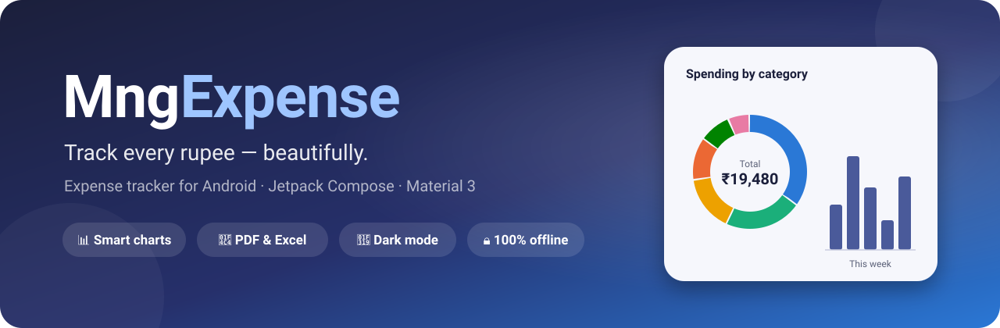
</p>

<p align="center">
  <a href="https://kotlinlang.org"></a>
  <a href="https://developer.android.com/compose"></a>
  
  
  <a href="LICENSE"></a>
</p>

<p align="center">
  <b>A clean, offline-first expense tracker for Android.</b><br/>
  Log spending in seconds, see where your money goes, and export polished reports to <b>PDF</b> or <b>Excel</b>.
</p>

<p align="center">
  <a href="#-screenshots">Screenshots</a> •
  <a href="#-features">Features</a> •
  <a href="#-architecture">Architecture</a> •
  <a href="#-getting-started">Getting Started</a> •
  <a href="#-roadmap">Roadmap</a>
</p>

---

## 📸 Screenshots

<p align="center">
  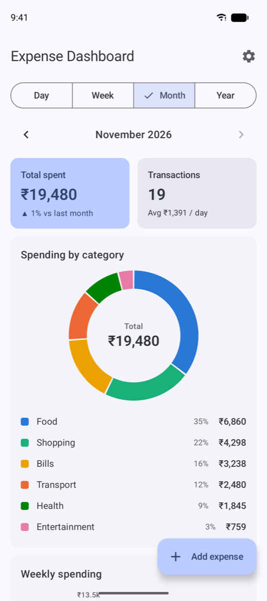
  &nbsp;
  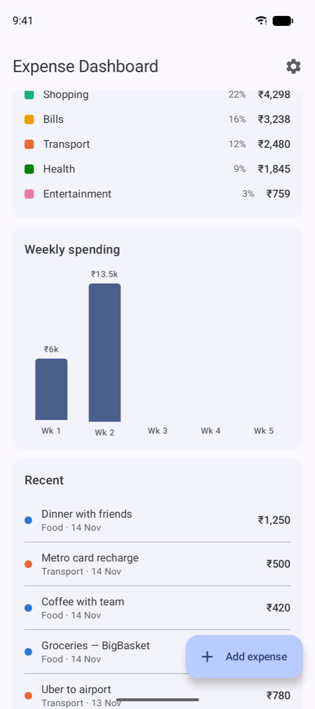
  &nbsp;
  
  &nbsp;
  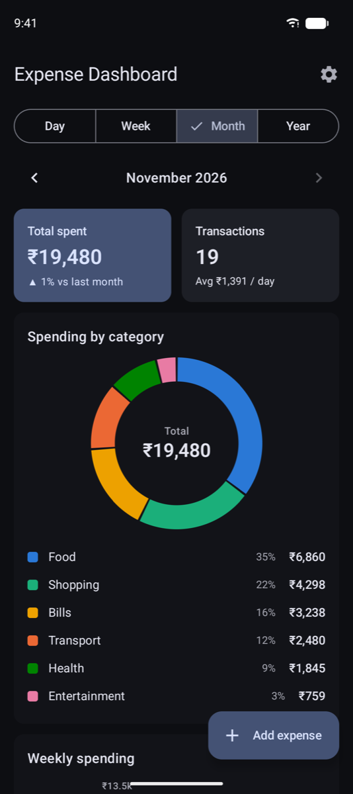
</p>

<details>
<summary><b>📅 Day · Week · Month · Year views</b></summary>
<br/>
<p align="center">
  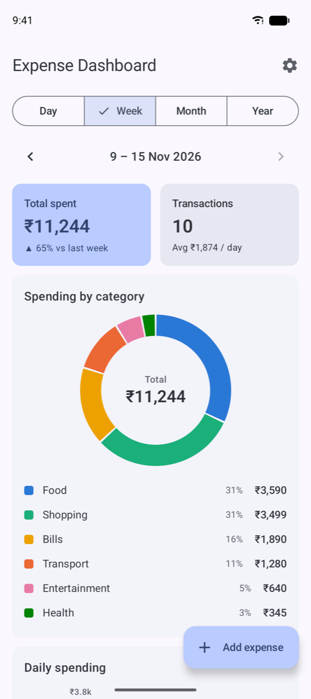
  &nbsp;
  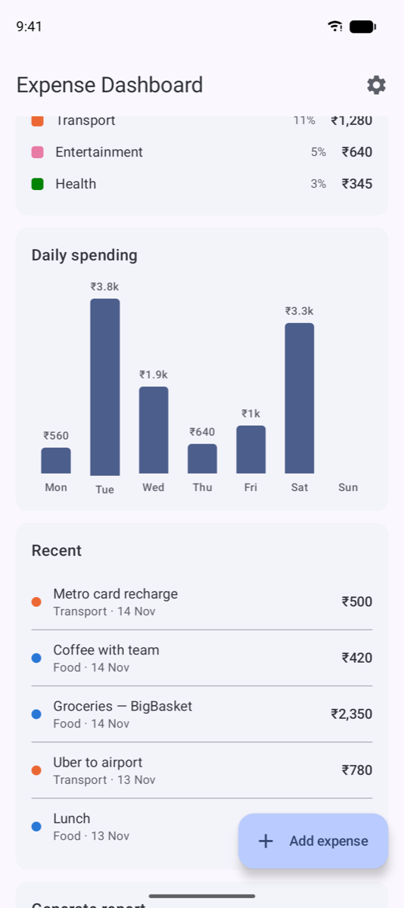
  &nbsp;
  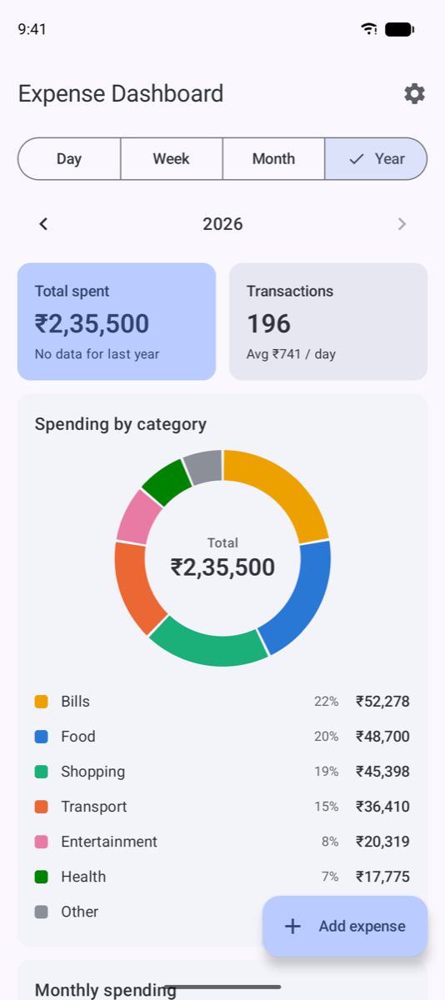
  &nbsp;
  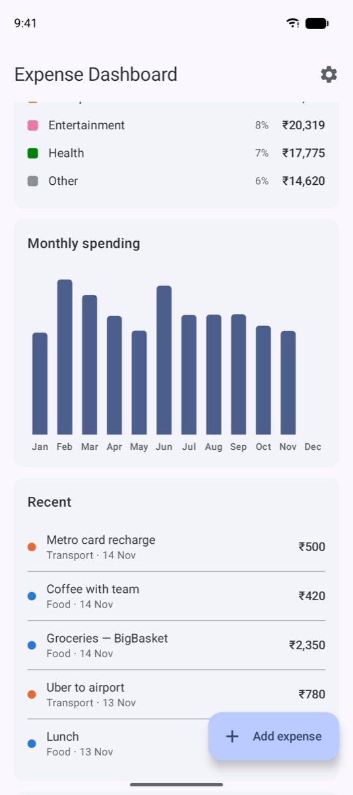
</p>
</details>

<details>
<summary><b>✏️ Add, edit & delete</b></summary>
<br/>
<p align="center">
  
  &nbsp;
  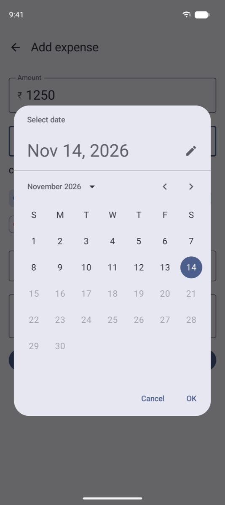
  &nbsp;
  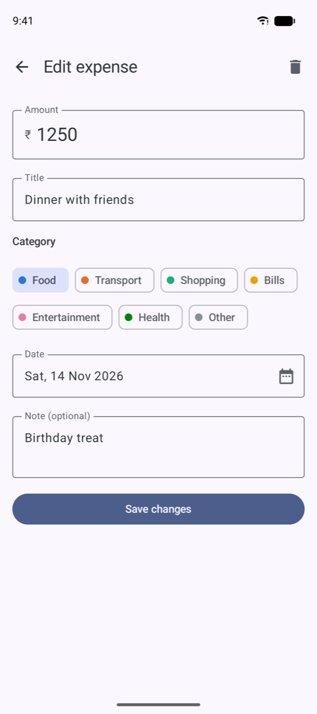
  &nbsp;
  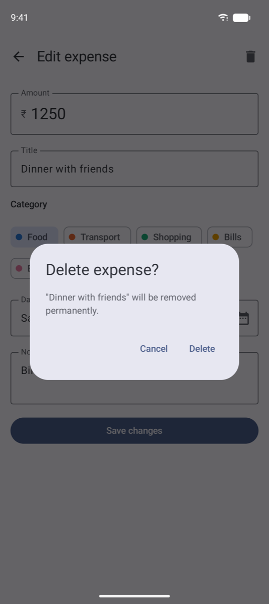
</p>
</details>

<details>
<summary><b>📄 Reports: PDF & Excel export</b></summary>
<br/>
<p align="center">
  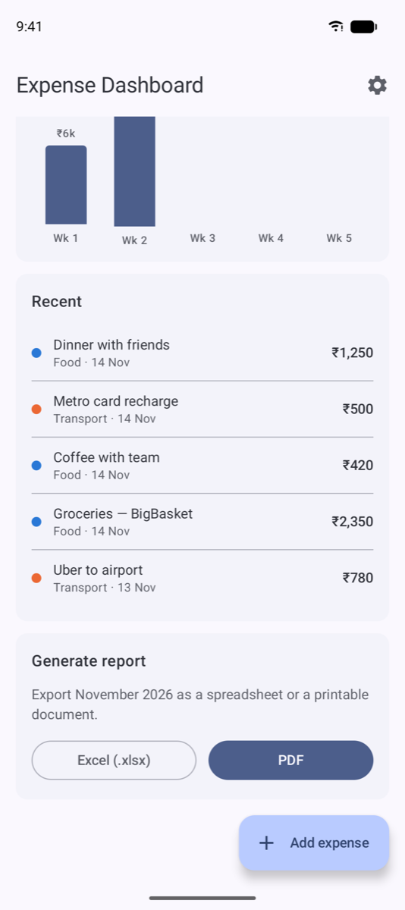
  &nbsp;
  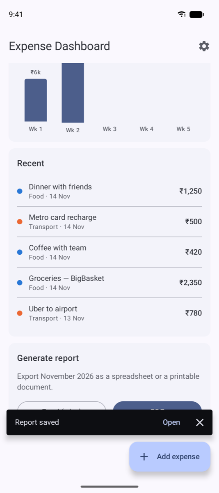
  &nbsp;
  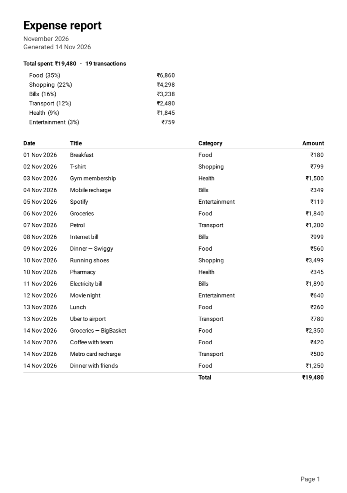
</p>
</details>

<details>
<summary><b>🌙 Dark mode & ⚙️ Settings</b></summary>
<br/>
<p align="center">
  
  &nbsp;
  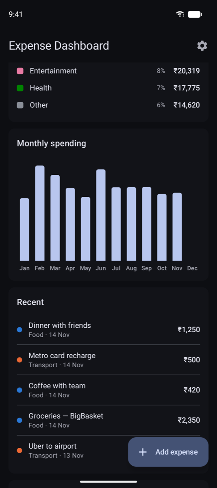
  &nbsp;
  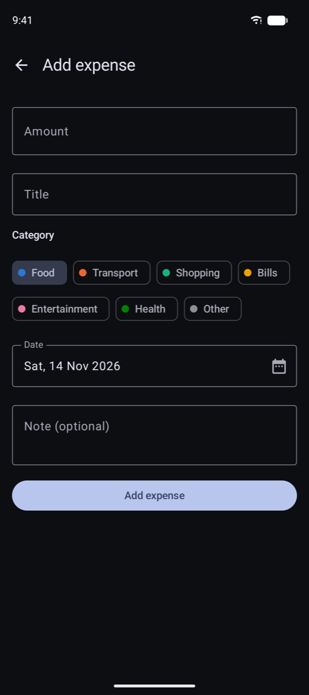
  &nbsp;
  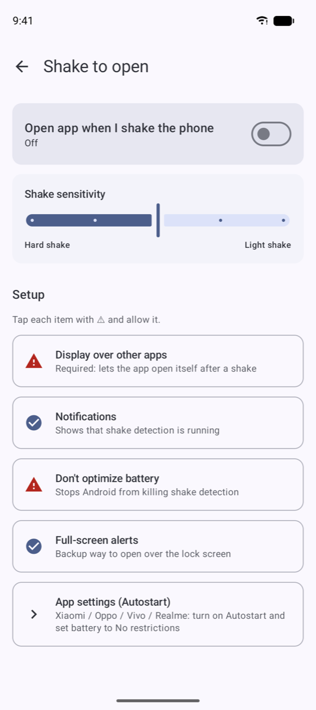
</p>
</details>

---

## ✨ Features

<table>
<tr>
<td width="50%" valign="top">

### 💰 Track
- Add, edit and delete expenses in a few taps
- **7 categories**: Food, Transport, Shopping, Bills, Entertainment, Health, Other
- Date picker that blocks future dates
- Optional notes on every expense
- Input checks for title and amount

</td>
<td width="50%" valign="top">

### 📊 Understand
- **Day / Week / Month / Year** filters
- Step back and forward through any period
- Animated **donut chart** by category
- Animated **bar chart**: by category, day, week or month
- Total spent, transaction count, daily average
- **% change vs the previous period** ▲▼

</td>
</tr>
<tr>
<td width="50%" valign="top">

### 📄 Export
- **PDF**: A4, multi-page, summary + full table, page numbers
- **Excel (.xlsx)**: *Expenses* sheet with a live `SUM` total + *Summary* sheet by category
- Save anywhere through the system file picker. **No storage permission needed.**
- Open the file right away from the "Report saved" snackbar

</td>
<td width="50%" valign="top">

### 🎨 Delight
- **Material You** dynamic colour on Android 12+
- Full **dark mode**
- Indian number formatting (`₹2,36,750`)
- **100% offline**: your data never leaves the device
- Optional **shake to open** the app, even from the lock screen

</td>
</tr>
</table>

---

## 🏗 Architecture

MngExpense follows **MVVM** with a single source of truth in Room. The UI observes `StateFlow`s, so every chart and total updates the moment an expense changes.

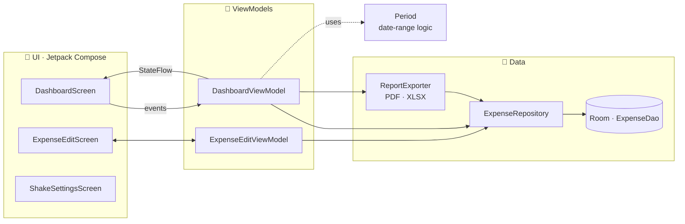

**Key design choices**
- 📆 **Dates are stored as epoch days**, not timestamps, so totals never shift with time zones.
- 🧮 **`Period`** is plain Kotlin (no Android types). It works out the date range, labels and chart buckets for each filter, and it's fully unit-tested.
- 📦 **No heavy libraries for reports.** PDFs use Android's built-in `PdfDocument`, and `.xlsx` files come from a small hand-written Office Open XML writer, which keeps the APK small.
- 🧭 **Navigation 3** with per-screen `ViewModelStore`s, so each screen gets fresh state.

---

## 🛠 Tech Stack

| Layer | Technology |
|---|---|
| **Language** | Kotlin 2.4 |
| **UI** | Jetpack Compose · Material 3 · Material Icons |
| **Architecture** | MVVM · Repository · `StateFlow` · unidirectional data flow |
| **Navigation** | AndroidX Navigation 3 |
| **Database** | Room 2.8 (KSP) |
| **Async** | Kotlin Coroutines & Flow |
| **Dates** | `java.time` + core library desugaring (works on API 24+) |
| **Reports** | `android.graphics.pdf.PdfDocument` · custom XLSX writer |
| **Build** | Gradle Kotlin DSL · Version Catalog · AGP 9 · R8 |
| **Testing** | JUnit 4 |

---

## 📂 Project Structure

```text
app/src/main/java/com/guruprasad/mngexpense/
├── MainActivity.kt              # Entry point + Navigation 3 graph
├── MngExpenseApp.kt             # Application: simple dependency container
├── Routes.kt                    # Type-safe navigation keys
│
├── domain/                      # Pure Kotlin, no Android types
│   ├── Expense.kt
│   ├── Category.kt
│   └── Period.kt                # Date ranges, labels, chart buckets
│
├── data/
│   ├── local/                   # Room: entity, DAO, database
│   ├── repository/              # ExpenseRepository
│   ├── export/                  # PdfWriter, XlsxWriter, ReportExporter
│   ├── service/                 # Shake detection (foreground service)
│   └── receivers/               # Restart shake service after reboot
│
├── ui/
│   ├── screens/
│   │   ├── dashboard/           # Dashboard UI + ViewModel
│   │   ├── expense/             # Add / Edit UI + ViewModel
│   │   └── setting/             # Shake-to-open settings
│   ├── common/                  # Category colours
│   └── theme/                   # Material 3 theme
│
└── util/                        # Currency formatting, preferences
```

---

## 🚀 Getting Started

### Requirements
- **Android Studio**, latest stable
- **JDK 17+**
- A device or emulator running **Android 7.0 (API 24)** or newer

### Build & run
```bash
git clone https://github.com/GuruDev1736/MngExpense.git
cd MngExpense
./gradlew installDebug
```

### Run the tests
```bash
./gradlew testDebugUnitTest
```

Tests cover the period logic (week boundaries, month/year rollover, labels, chart buckets), currency formatting, and the XLSX writer (valid package, XML escaping, Excel date serials, `SUM` formula).

---

## 🔐 Permissions

Every permission is optional except where noted, and all of them are for the **shake-to-open** feature only. Expense tracking and exports need **none**.

| Permission | Why |
|---|---|
| `FOREGROUND_SERVICE` / `FOREGROUND_SERVICE_SPECIAL_USE` | Keeps shake detection running in the background |
| `POST_NOTIFICATIONS` | Shows the "Shake to open is on" notification |
| `SYSTEM_ALERT_WINDOW` | Lets the app open itself after a shake |
| `USE_FULL_SCREEN_INTENT` | Fallback to open over the lock screen |
| `RECEIVE_BOOT_COMPLETED` | Restarts shake detection after a reboot (only if you turned it on) |

> [!NOTE]
> Shake-to-open is **off by default**. Reports are saved through Android's Storage Access Framework, so the app never asks for storage access.

---

## 🗺 Roadmap

- [x] Add / edit / delete expenses
- [x] Day, week, month and year dashboards with charts
- [x] PDF & Excel export
- [x] Dark mode & dynamic colour
- [ ] 🎯 Monthly budgets with alerts
- [ ] 🔍 Search & filter transactions
- [ ] ⚡ Quick Settings tile, app shortcut & home-screen widget for faster entry
- [ ] 🔁 Recurring expenses
- [ ] ☁️ Backup & restore
- [ ] 💱 Multiple currencies

---

## 🤝 Contributing

Contributions are welcome!

1. Fork the repository
2. Create a branch: `git checkout -b feature/amazing-feature`
3. Commit your changes: `git commit -m "Add amazing feature"`
4. Push the branch: `git push origin feature/amazing-feature`
5. Open a Pull Request

Found a bug or have an idea? [Open an issue](https://github.com/GuruDev1736/MngExpense/issues).

---

## 📄 License

Distributed under the **MIT License**. See [`LICENSE`](LICENSE) for details.

<p align="center">
  <br/>
  Made with ❤️ and Jetpack Compose<br/>
  <sub>If you find this project useful, please consider giving it a ⭐</sub>
</p>
